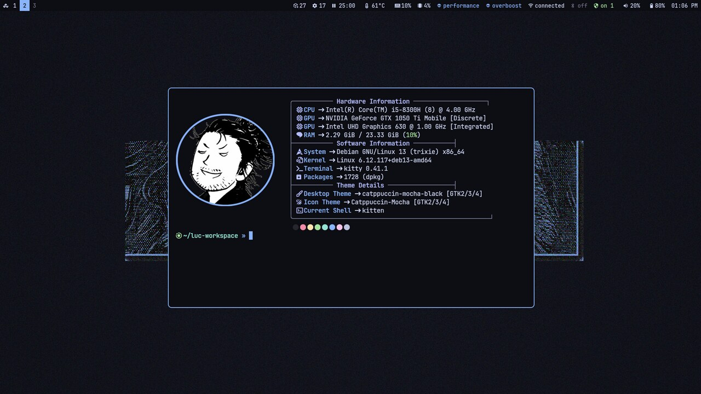
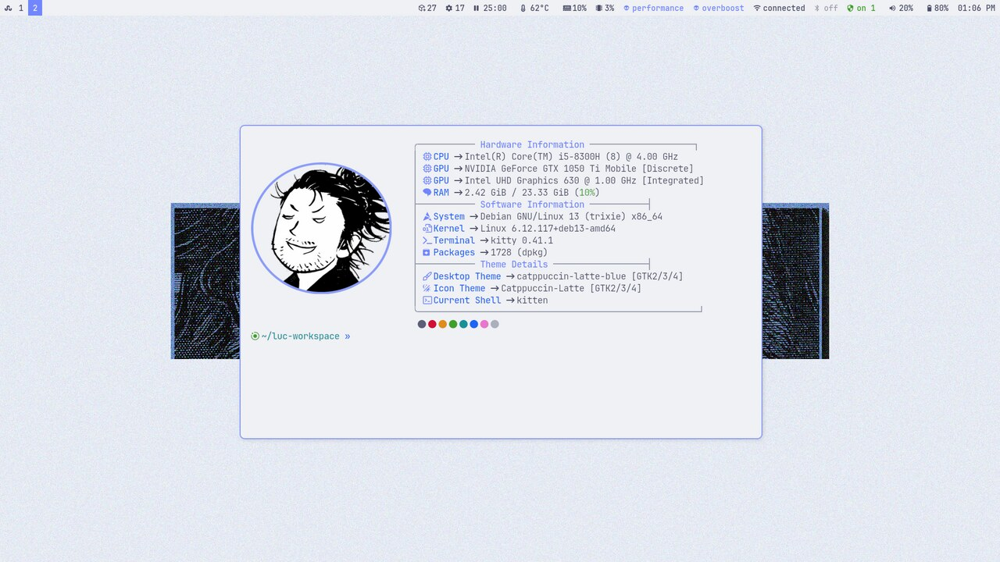
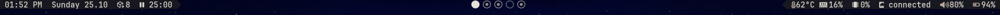
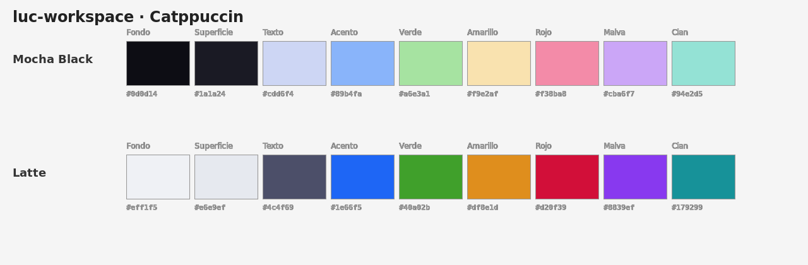

# luc-workspace · bspwm + polybar · Debian 13

Escritorio mínimo y reproducible sobre Debian 13: Xorg, bspwm, sxhkd,
polybar, picom, dunst, rofi, kitty, PipeWire, Brave, ranger, zathura,
VLC, Herdr y ytwatch.

Versión 1.0.0 · `startx` manual, sin display manager.

## Capturas







## Requisitos

- Debian 13 minimal, x86_64, systemd.
- Usuario no-root con home real y `sudo`.
- `git` e Internet.

## Instalación

```sh
sudo apt update && sudo apt install -y git
git clone https://github.com/luiscbedoya/luc-workspace
cd luc-workspace
./install.sh --dry-run
./install.sh
sudo reboot
startx
```

## Opciones

| Opción | Efecto |
|---|---|
| `--dry-run` | Ver el plan sin modificar nada |
| `--yes` | Sin confirmación |
| `--theme mocha-black\|latte` | Tema oscuro o claro |
| `--no-ytwatch` | Omite ytwatch |
| `--no-herdr` | Omite Herdr |
| `--help` | Ayuda completa |

## Paleta



| Uso | Mocha Black | Latte |
|---|---|---|
| Fondo | `#0d0d14` | `#eff1f5` |
| Superficie | `#1a1a24` | `#e6e9ef` |
| Texto | `#cdd6f4` | `#4c4f69` |
| Acento | `#89b4fa` | `#1e66f5` |
| Verde | `#a6e3a1` | `#40a02b` |
| Amarillo | `#f9e2af` | `#df8e1d` |
| Rojo | `#f38ba8` | `#d20f39` |
| Malva | `#cba6f7` | `#8839ef` |
| Cian | `#94e2d5` | `#179299` |

## Diagnóstico

`desktop-doctor` · log: `~/.local/state/luc-workspace/session.log`

## Documentación

- [`docs/install.md`](docs/install.md) — instalación, migración, backups, sesión, hardware y limitaciones.
- [`docs/usage.md`](docs/usage.md) — atajos, apps, tema y uso diario.
- [`docs/hardware.md`](docs/hardware.md) — hardware y detección.
- [`docs/testing.md`](docs/testing.md) — pruebas.
- [`AGENTS.md`](AGENTS.md) · [`PROGRESS.md`](PROGRESS.md) · [`DECISIONS.md`](DECISIONS.md)
